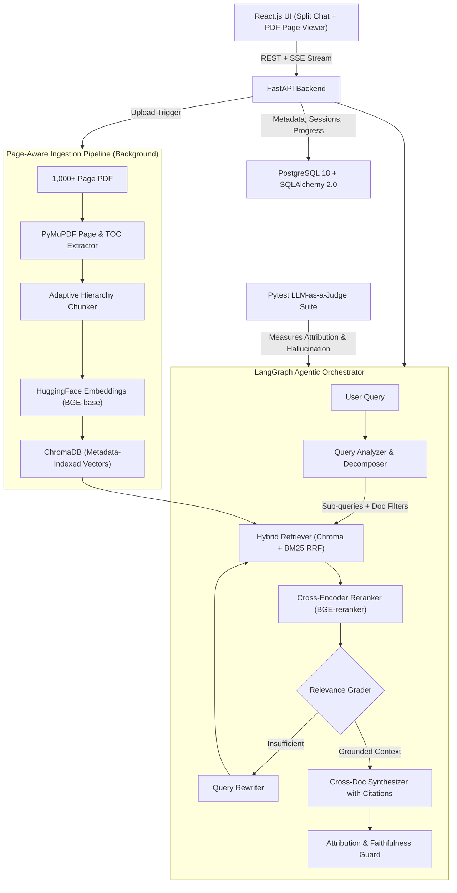

# Execution Plan: Agentic Book & Document Research Assistant (`readwise-ai`)

## 1. Local Environment Audit (Verified)
Your machine already has the core infrastructure needed to build and benchmark this system locally:
- **Python**: `3.12.6` (`C:\Python312\python.exe`, used for `backend/.venv`) and `3.13`
- **Node.js / npm**: `v23.4.0` / `11.6.2`
- **Database**: `postgresql-x64-18` Windows service is installed and **Running** (`psql.exe` at `C:\Program Files\PostgreSQL\18\bin\psql.exe`)
- **GPU**: `NVIDIA GeForce RTX 4050 Laptop GPU` (`6141 MiB` VRAM) — accelerates local HuggingFace embedding and cross-encoder reranking models significantly
- **Docker**: `29.5.2` installed (optional for containerization later)

---

## 2. System Architecture

---

## 3. Complete Required Tech Stack

### Backend & Persistence
| Layer | Technology | Purpose |
| :--- | :--- | :--- |
| **API Framework** | **FastAPI** + **Uvicorn** + `sse-starlette` | Async REST endpoints, large multi-PDF uploads, SSE streaming of agent steps & tokens |
| **Validation / Config** | **Pydantic v2** + `pydantic-settings` | Strict citation schemas (`doc_id`, `page_number`, `section`, `quote`) & typed `.env` config |
| **Relational DB** | **PostgreSQL 18** + **SQLAlchemy 2.0 (async)** + `asyncpg` + **Alembic** | Stores `documents`, ingestion progress, TOC trees, `research_sessions`, `messages`, and citation JSON |

### Document Parsing, Embeddings & Vector Search
| Layer | Technology | Purpose |
| :--- | :--- | :--- |
| **PDF Parsing** | **PyMuPDF (`pymupdf`)** + `pymupdf4llm` | High-speed C-backed page extraction for 1,000+ page PDFs, TOC/bookmark extraction, font-size heading detection |
| **Adaptive Chunking** | Custom Python Chunker + `tiktoken` | Preserves chapter/section boundaries, adapts chunk sizes (narrative vs tables/lists), embeds exact page ranges |
| **Embeddings** | **HuggingFace** (`langchain-huggingface` + `sentence-transformers` + `torch`) | Local dense embeddings (recommended: `BAAI/bge-base-en-v1.5` on RTX 4050 CUDA) |
| **Vector Database** | **ChromaDB** (`chromadb`, `langchain-chroma`) | Persistent local vector index with metadata filtering (`doc_id`, `page_number`, `chapter`) |
| **Hybrid & Reranking** | `rank-bm25` + HuggingFace Cross-Encoder | Combines dense semantic search + lexical BM25 via RRF, then reranks top candidates (`BAAI/bge-reranker-base`) |

### Agentic Orchestration & LLM Layer
| Layer | Technology | Purpose |
| :--- | :--- | :--- |
| **Orchestration** | **LangChain** + **LangGraph** | Stateful graph for query decomposition, multi-doc routing, self-correcting retrieval loops, and cross-document comparison |
| **LLM Provider** | Pluggable Factory (`Gemini` / `OpenAI` / `Groq` / `Ollama`) | Separates generation LLM (fast/cost-effective) from Judge LLM (high-reasoning) |

### Evaluation Framework
| Layer | Technology | Purpose |
| :--- | :--- | :--- |
| **Test & Eval Runner** | **Pytest** + `pytest-asyncio` + `httpx` | Automated RAG regression suite with structured Pydantic LLM-as-a-Judge scoring |
| **Metrics** | Custom Claim-Level Judge + Deterministic Attribution Checks | Measures **Source Attribution Accuracy** (target >=95%), **Faithfulness / Hallucination Rate** (target ~5%), and **Answer Relevance** |

### Frontend
| Layer | Technology | Purpose |
| :--- | :--- | :--- |
| **UI Framework** | **React.js** (via **Vite**) + **Tailwind CSS** + `lucide-react` | Split-pane research workspace (document library, chat + reasoning trace, PDF viewer) |
| **PDF Page-Jump Viewer** | `react-pdf` (`pdfjs-dist`) | Clicking `[Book Title, p. 142]` jumps straight to page 142 and highlights the cited excerpt |
| **Rich Rendering** | `react-markdown` + `remark-gfm` + `rehype-katex` | Renders comparative tables, structured citations, and mathematical notation from textbooks |

---

## 4. How We Hit the Engineering Benchmarks

1. **Handling 1,000+ Page Books Without Timeouts or Context Drift**
   - Stream PDF pages iteratively with PyMuPDF (`fitz`) and strip repeating header/footer lines using top/bottom bounding-box heuristics.
   - Run ingestion asynchronously via FastAPI background workers while persisting page progress (`pages_processed / total_pages`) in PostgreSQL.
   - Deduplicate uploads via SHA-256 hash so large books aren't re-embedded twice.

2. **Page-Aware Adaptive Chunking & 95%+ Source Attribution**
   - Never merge text blindly across major heading boundaries or lose page numbers: each chunk stores `doc_id`, `doc_title`, `page_start`, `page_end`, `chapter`, `section`, and `chunk_index`.
   - Adapt target chunk sizes dynamically: longer cohesive windows (~700–1,000 tokens) for narrative chapters, tighter windows (~250–450 tokens) for tables, code blocks, or definitions.
   - Use **Hybrid Search (ChromaDB + BM25)** + **Cross-Encoder Reranking**, followed by a deterministic **Citation Verifier** that maps every `[cite: chunk_id]` emitted by the LLM back to actual retrieved chunk metadata—eliminating hallucinated page numbers.

3. **Agentic Query Decomposition & Cross-Document Comparison**
   - A **Query Analyzer** node detects whether a prompt is single-document factual, multi-hop, or cross-document comparative.
   - For comparisons (e.g., *"Compare how Document A and Document B explain X"*), the **Decomposer** dispatches independent filtered retrieval sub-queries per `doc_id`, ensuring one longer book doesn't drown out another in vector top-K.
   - A **Relevance Grader** triggers query reformulation if retrieved evidence is weak, or returns an explicit grounded abstention when evidence is missing.

4. **LLM-as-a-Judge Pytest Framework (~5% Hallucination Rate)**
   - Build a curated golden dataset (`backend/evals/datasets/`) containing single-page lookups, multi-doc synthesis, cross-document comparisons, and adversarial unanswerable questions.
   - Decompose generated answers into atomic factual claims and evaluate each claim strictly against the retrieved chunks (`supported` vs `unsupported`), flagging hallucinations quantitatively in CI/local pytest runs.

---

## 5. Phased Execution Plan

### Phase 0: Starting Setup (Completed Now — Zero Application Code)
- Initialized Python 3.12 virtual environment at `backend/.venv`
- Created full project folder hierarchy (`backend/`, `frontend/`, `data/`, `evals/`, `tests/`)
- Added `.gitignore`, `.env.example`, and `backend/requirements.txt`

### Phase 1: Dependencies, Database & Frontend Bootstrapping
1. Install Python dependencies into `backend/.venv` (with CUDA-enabled PyTorch if using RTX 4050, or CPU PyTorch).
2. Create the `readwise_ai` database in local PostgreSQL 18 and configure `.env`.
3. Initialize Alembic migrations inside `backend/alembic/`.
4. Scaffold the React app inside `frontend/` using Vite + Tailwind CSS.

### Phase 2: Core Backend & PostgreSQL Schema
1. Implement typed config (`app/core/config.py`) and async SQLAlchemy engine (`app/core/database.py`).
2. Define ORM models: `Document`, `DocumentChunkIndex`, `ResearchSession`, `Message`.
3. Build FastAPI health, document upload/status, and session management endpoints.

### Phase 3: Page-Aware PDF Ingestion & Adaptive Chunking
1. Build `PyMuPDF` extractor (text, bounding-box header/footer cleanup, TOC/heading tree, page count).
2. Build adaptive chunker preserving chapter/section hierarchy and exact page metadata.
3. Integrate HuggingFace embeddings + ChromaDB persistence + background ingestion status updates.

### Phase 4: Hybrid Retrieval & Agentic Orchestration
1. Build metadata-filtered ChromaDB + BM25 hybrid retriever with RRF and Cross-Encoder reranker.
2. Implement the LangGraph agent workflow (Query Decomposer → Multi-Doc Retriever → Relevance Grader → Comparative Synthesizer → Citation Guard).
3. Expose SSE streaming chat endpoint emitting live agent step events and structured citations.

### Phase 5: React Research Assistant UI
1. Build Document Library sidebar (multi-PDF upload, live indexing progress bar, document scope checkboxes).
2. Build Research Chat pane (streaming answers, collapsible agent reasoning steps, inline clickable citation pills).
3. Build Split-Pane PDF Viewer (`react-pdf`) that opens and jumps directly to the clicked citation's page.

### Phase 6: LLM-as-a-Judge Evaluation & Optimization
1. Author golden multi-document evaluation dataset (covering factual, cross-doc, and unanswerable queries).
2. Implement Pytest evaluation suite measuring Attribution Accuracy, Context Recall, Answer Relevance, and Claim-Level Hallucination Rate.
3. Run baseline benchmark, tune chunk sizes / reranker thresholds / grounding prompts, and save evaluation report artifacts.

---

## 6. Decisions Needed Before Phase 1
1. **LLM Provider**: Which primary LLM (and Judge LLM) do you want to configure? (e.g., Gemini API, OpenAI, Groq, or local Ollama)
2. **PyTorch Acceleration**: Install CUDA-enabled PyTorch for your RTX 4050 GPU (recommended for fast embedding/reranking of 1,000+ page PDFs) or CPU-only?
3. **Frontend Language**: React with **TypeScript** (recommended) or **JavaScript**?
